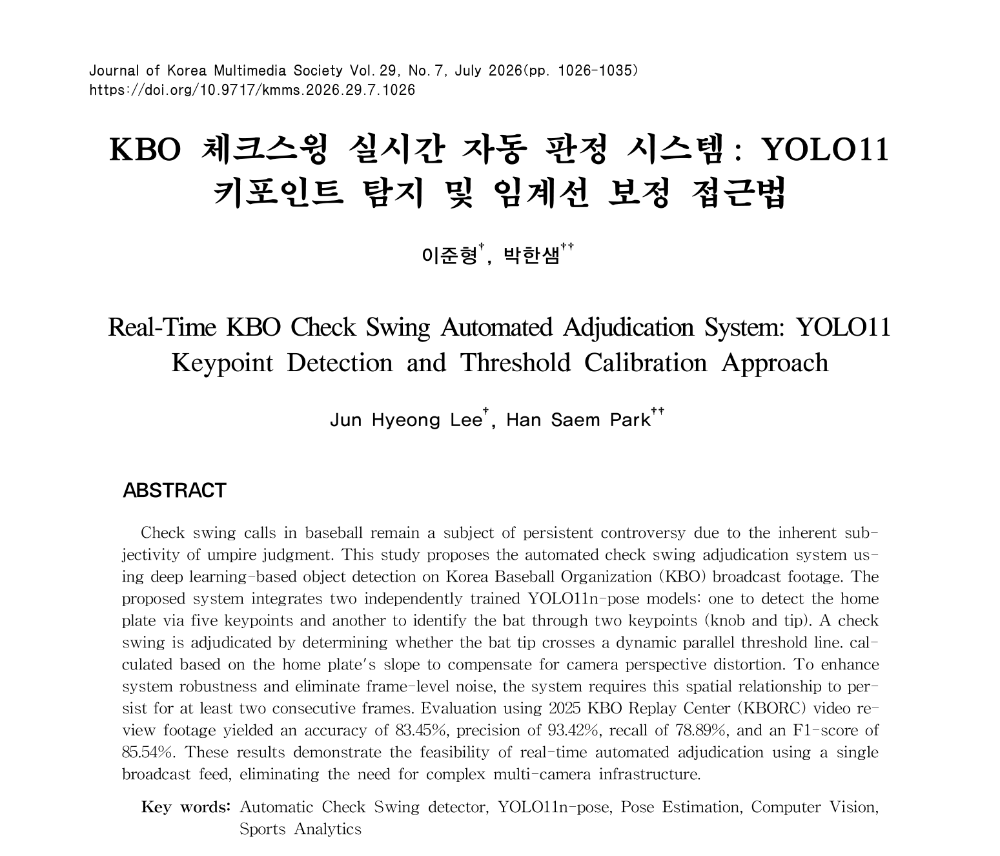
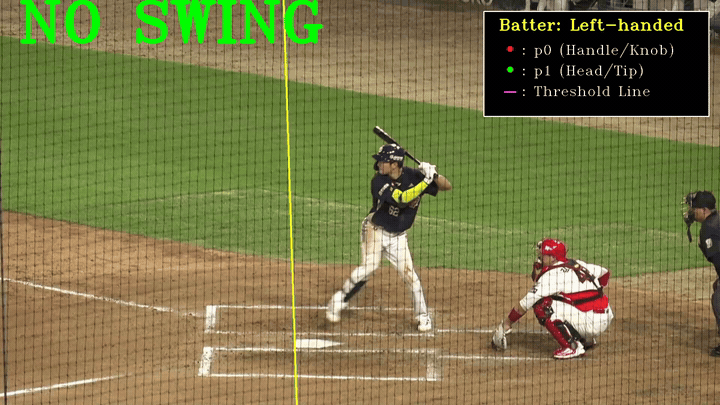
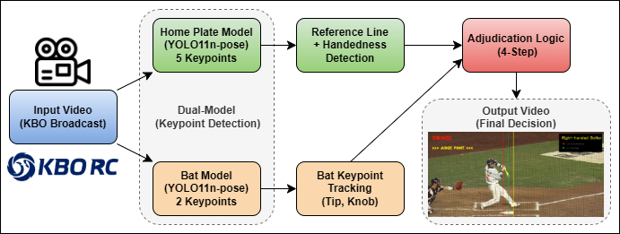

# ⚾ KBO Check Swing Automated Adjudication System

<p align="center">
  
</p>

<p align="center">
  
</p>

<p align="center">
  <a href="https://doi.org/10.9717/kmms.2026.29.7.1026">
    
  </a>
  
  
  
  
  
</p>

---

## 📄 Paper

> **KBO 체크스윙 실시간 자동 판정 시스템: YOLO11 키포인트 탐지 및 임계선 보정 접근법**  
> Jun Hyeong Lee, Han Saem Park  
> *Journal of Korea Multimedia Society*, Vol. 29, No. 7, pp. 1026–1035, July 2026  
> 📎 **DOI**: [10.9717/kmms.2026.29.7.1026](https://doi.org/10.9717/kmms.2026.29.7.1026)

---

## 📌 Overview

야구 경기에서 **체크스윙(Check Swing)** 판정은 심판의 주관적 판단에 의존해 왔으며, KBO는 2025시즌부터 비디오 판독 제도를 도입하였습니다. 그러나 감독 요청에 의한 제한적 운용(팀당 2회)이라는 시스템적 한계가 존재합니다.

본 연구는 **단일 KBO 중계 영상만을 활용**하여 고가의 다중 카메라 인프라 없이 체크스윙을 **실시간으로 자동 판정**하는 딥러닝 파이프라인을 최초로 제안합니다.

---

## ✨ Key Contributions

1. **단일 중계 영상 기반 실시간 자동 판정** 파이프라인 최초 제안
2. **홈플레이트 방향성 인식 + 다수결 투표**를 통한 좌/우타자 자동 판별 (사전 설정 불필요)
3. **카메라 원근 왜곡 보정** — 홈플레이트 기울기 기반 동적 임계선(x_th) 생성
4. **프레임 연속성(Frame-Continuity) 검증 로직** — 최소 2프레임 연속 교차 시에만 SWING 판정, 오탐 억제
5. **KBO 비디오 판독 센터(KBORC)** 공식 제공 영상 기반 검증

---

## 📊 Performance

평가 대상: KBO 2025 정규시즌 KBORC 공식 판독 영상 **145건 전수**

| Metric | Value |
|--------|-------|
| **Accuracy** | 83.45% |
| **Precision** | **93.42%** |
| Recall | 78.89% |
| **F1-Score** | **85.54%** |

- 배트 프레임 단위 탐지율: **평균 91.95%** (전체 16,723 프레임)
- 홈플레이트 프레임 단위 탐지율: **평균 92.99%**
- 통합 추론 속도: **20.95ms/frame (약 47.7 FPS)** → 실제 60FPS 중계에 실시간 적용 가능

---

## 🏗️ System Architecture

<p align="center">
  
</p>

---

## 🔬 Model Specifications

| Configuration | Home Plate Model | Bat Model |
|---|---|---|
| Base Model | YOLO11n-pose | YOLO11n-pose |
| Keypoints | 5 (꼭짓점) | 2 (Knob, Tip) |
| Dataset | 200장 (Train 140 / Val 40 / Test 20) | 291장 (Train 204 / Val 58 / Test 29) |
| Image Size | 1920 × 1080 | 1920 × 1080 |
| Epochs / Batch | 50 / 16 | 50 / 16 |
| Optimizer | AdamW (lr=0.002) | AdamW (lr=0.002) |
| GPU | NVIDIA A100 | NVIDIA A100 |
| Confidence Threshold | 0.3 | 0.3 |

### YOLO11 vs YOLOv8 Comparison

| Model | Metric | YOLOv8n | YOLO11n | Diff |
|---|---|---|---|---|
| Home Plate | mAP50 | 0.995 | 0.995 | 0.0% |
| Home Plate | mAP50-95 | 0.968 | **0.983** | +1.5% |
| Home Plate | Inference (ms/frame) | 1.9ms | 2.6ms | +0.7ms |
| Bat | mAP50 | 0.989 | **0.991** | +0.2% |
| Bat | mAP50-95 | 0.983 | 0.978 | -0.5% |
| Bat | Inference (ms/frame) | 2.8ms | **2.4ms** | **-0.4ms** ✅ |

---

## 📁 Repository Structure

```
kbo-checkswing-detection/
├── inference.py                  # ⭐ 단일 영상 자동 판정 및 시각화 CLI 모듈
├── checkswing_main_v30.ipynb     # 메인 판정 파이프라인 (Colab)
├── bat_model_train.ipynb         # 배트 감지 모델 학습 (YOLO11n-pose)
├── homeplate_model.ipynb         # 홈플레이트 감지 모델 학습 (YOLO11n-pose)
├── evaluate_kbo_dataset.py       # KBORC 145건 전수 데이터셋 배치 평가
├── model_evaluation.ipynb        # 모델 성능 지표 및 시각화
├── generate_charts.py            # 논문 성능 차트 및 그래프 생성
├── assets/
│   ├── paper_header.png          # 논문 헤더 이미지
│   ├── demo.gif                  # 실시간 판정 데모 애니메이션
│   └── pipeline.png              # 시스템 파이프라인 다이어그램
└── README.md
```

---

## 🚀 Quick Start

### 1. Requirements

```bash
pip install ultralytics opencv-python numpy
```

### 2. Run Inference (CLI)

```bash
# 단일 영상 판정 및 결과 영상 저장
python inference.py --video data/videos/sample.mp4 --output output/result.mp4

# 실시간 시각화 창 띄우기
python inference.py --video data/videos/sample.mp4 --show
```

### 3. Python API

```python
from inference import CheckSwingDetector

detector = CheckSwingDetector(
    homeplate_model_path="models/homeplate.pt",
    bat_model_path="models/best.pt",
    conf_threshold=0.3,
    margin_px=20,
    min_consecutive_frames=2
)

result = detector.run(video_path="sample.mp4", output_path="output/result.mp4")
print(result["decision"])  # "SWING" or "NO SWING"
```

---

## 🏆 Related Achievements

- 📄 **KCI 등재 논문 게재** — *Journal of Korea Multimedia Society*, Vol.29, No.7, 2026
- 🥉 **상명대학교 캡스톤 디자인 경진대회 장려상** (AMI 팀, 소프트웨어학과, 2026-1)

---

## 💡 Limitations & Future Work

- 단일 중계 카메라 앵글에 대한 기하학적 의존성 존재
- 심각한 모션 블러 구간에서 키포인트 수축(Keypoint Shrinkage) 현상 발생
- 향후 계획: LSTM 기반 시계열 추적 모델 결합, 다년도 데이터 확장, 부트스트랩 기반 통계 검증

---

## 👥 Authors

| | |
|---|---|
| **이준형 (Jun Hyeong Lee)** | 상명대학교 소프트웨어학과 / 관심분야: 컴퓨터비전, 딥러닝, 스포츠 데이터 분석 |
| **박한샘 (Han Saem Park)** | 상명대학교 소프트웨어학과 조교수 (교신저자) / 관심분야: 컴퓨터비전, 분산학습, 도메인 일반화 |

📧 leejunhyeong02@gmail.com

---

## 📜 Citation

```bibtex
@article{lee2026kbo,
  title     = {KBO 체크스윙 실시간 자동 판정 시스템: YOLO11 키포인트 탐지 및 임계선 보정 접근법},
  author    = {Lee, Jun Hyeong and Park, Han Saem},
  journal   = {Journal of Korea Multimedia Society},
  volume    = {29},
  number    = {7},
  pages     = {1026--1035},
  year      = {2026},
  doi       = {10.9717/kmms.2026.29.7.1026}
}
```

---

## 🙏 Acknowledgments

This work was supported by the **National Research Foundation of Korea (NRF)** grant funded by the Korea government (MSIT) **(RS-2026-25499616)** and was conducted using official replay video data from the KBO Replay Center (KBORC).

---

## ⚠️ Data & Model Notice

본 연구에 사용된 KBO 중계 영상 및 KBORC 판독 데이터는 연구 목적으로만 활용되었습니다.  
모델 가중치(.pt) 및 데이터셋은 저작권 보호로 인해 공개하지 않습니다.
